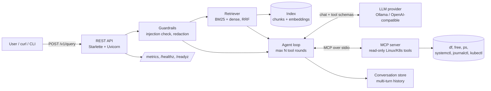

# OpsLens
[](https://github.com/falguniborkar2-blip/opslens/actions) 

**A small, pluggable framework for building RAG + MCP powered conversational assistants for
Linux and Kubernetes operations.**

Ask *"Why is my pod in CrashLoopBackOff?"* or *"Is my disk full?"* and OpsLens:

1. **checks the question** with guardrails (prompt-injection heuristics, length limits),
2. **retrieves** the most relevant documentation using **hybrid search** (BM25 + embeddings,
   fused with Reciprocal Rank Fusion),
3. lets the LLM **call read-only diagnostic tools** (`df`, `free`, `systemctl status`,
   `journalctl`, `kubectl get/describe`) exposed through a **Model Context Protocol (MCP) server**,
4. returns an answer with **numbered source citations**, the tool calls it made, token usage and
   latency, with any secrets in logs or tool output **redacted**.

It runs fully locally and open source with [Ollama](https://ollama.com), and works with any
OpenAI-compatible backend (vLLM, OpenAI, Groq, ...) by changing one config value.



## Features

| Area | What is implemented |
|---|---|
| **LLM providers** | `LLMProvider` protocol, OpenAI-compatible client with retries/back-off, a deterministic fake provider for tests and CI |
| **RAG** | Markdown-aware chunking with overlap, Okapi **BM25 written from scratch**, dense retrieval with cosine similarity, **hybrid search via Reciprocal Rank Fusion** |
| **Tools (MCP)** | MCP server with 7 **read-only** tools; no shell, argument allowlists/regex validation, timeouts, output truncation; usable from any MCP client |
| **Agent** | Function-calling loop with a bounded number of tool rounds, grounded system prompt, source citations, multi-turn conversation memory |
| **Guardrails** | Prompt-injection heuristics, input limits, secret redaction (API keys, tokens, passwords, private keys) |
| **Evaluation** | Labelled question set + IR metrics (Recall@k, MRR, MAP@k); a **quality gate in CI** fails if retrieval regresses |
| **Ops** | REST API, Prometheus-style `/metrics`, Kubernetes liveness/readiness probes, UBI-based `Containerfile`, `compose.yaml`, Kubernetes manifest |
| **Quality** | 33 pytest tests, `ruff` lint + format, `mypy --strict`, GitHub Actions on Python 3.11-3.13 plus a Podman container build and smoke test |

## Quick start (local, free, open source)

```bash
# 1. Model server
ollama pull llama3.2:3b          # chat model with tool-calling support
ollama pull nomic-embed-text     # embedding model for hybrid search

# 2. Install
python -m venv .venv && source .venv/bin/activate
pip install -e ".[dev]"

# 3. Build the index (chunks + embeddings) and try it
opslens ingest
opslens ask "My pod keeps restarting, what should I check?"
opslens ask "Is my root disk running out of space?"     # triggers the disk_usage MCP tool

# 4. Run the API
opslens serve --port 8080
curl -s localhost:8080/v1/query -H 'content-type: application/json' \
     -d '{"query": "How do I open port 8080 in the firewall on RHEL?"}' | jq
```

No Ollama? Use BM25 only: `OPSLENS_RAG_MODE=bm25 opslens ingest --no-embeddings`.
Use a hosted model: set `OPSLENS_LLM_BASE_URL`, `OPSLENS_LLM_MODEL` and `OPSLENS_LLM_API_KEY`.

### Containers

```bash
podman build -t opslens -f Containerfile .
podman compose up                  # OpsLens + Ollama
kubectl apply -f deploy/k8s/opslens.yaml
```

### Use the MCP server on its own

The tools server is a standard MCP server, so other MCP clients can use it too:

```bash
opslens mcp-server                 # speaks MCP over stdio
npx @modelcontextprotocol/inspector opslens mcp-server   # explore it interactively
```

## API

| Method | Path | Description |
|---|---|---|
| `POST` | `/v1/query` | `{"query": str, "conversation_id"?: str}` → answer, sources, tool calls, tokens, latency |
| `GET` | `/v1/conversations/{id}` | conversation history |
| `GET` | `/v1/tools` | MCP tools available to the model (JSON schema) |
| `GET` | `/healthz`, `/readyz` | liveness / readiness |
| `GET` | `/metrics` | query, block, error, tool-call and token counters |

## Retrieval evaluation

`eval/questions.yaml` holds 37 questions written the way users phrase them (not copied from the
docs), each labelled with the documents that answer it. Run `opslens eval -k 3`:

| mode | n | R@1 | R@3 | MRR | MAP@3 |
|---|---|---|---|---|---|
| bm25   | 37 | 0.716 | 0.932 | 0.867 | 0.829 |
| dense  | 37 | 0.905 | 0.986 | 0.986 | 0.964 |
| hybrid | 37 | 0.811 | 0.973 | 0.928 | 0.899 |

The one BM25 miss, *"Allow httpd to talk to a database over the network"*, is a vocabulary
mismatch (the docs say "Apache" and "connect"). Dense and hybrid search both find it.
See "What I learned" for why dense still beats hybrid.

## Project layout

```
src/opslens/
  providers/   LLM backends (OpenAI-compatible, fake)       config.py     YAML + env settings
  rag/         chunker, BM25, hybrid index                  agent.py      RAG + tool-calling loop
  tools/       MCP server (tools) + MCP client bridge       guardrails.py injection + redaction
  eval/        IR metrics + evaluation runner               api.py / cli.py
data/docs/     knowledge base (Markdown)                    eval/         labelled questions
tests/         unit + integration tests                     deploy/k8s/   Kubernetes manifest
```

## What I learned

- I expected hybrid search to win, but dense search was best on my 37 test questions
  (Recall@3 0.986 vs 0.973 for hybrid). My questions are paraphrased, so BM25 is the
  weaker ranker here. Plain RRF gives both rankings equal weight, so BM25 pulls the
  hybrid result down. Next I want to try weighted RRF.
- MCP (Model Context Protocol) is a standard way to give an LLM tools. I write a tool
  once in an MCP server, and any MCP client can list it and call it.
- All tools are read-only on purpose. A small model can call the wrong tool or invent
  arguments, so it must not be able to change or delete anything on the system.
- Measuring retrieval separately from the LLM made it much easier to find problems.

## Problems I hit

- **Model invented tool arguments.** For "My pod keeps restarting", llama3.2:3b called
  `service_status` with `{"unit": "your_unit_name"}`. I added a check that finds
  placeholder values like `your_...` or `<pod-name>`. The tool is not run, and the
  model gets an error telling it to ask the user instead. I added a unit test and
  checked with `opslens ask ... --json` that the tool output is the error message.
  After the fix the model asked me for the real name.
- **Wrong document ranked first (still open).** The same question returned the systemd
  section "Service keeps restarting" before the Kubernetes CrashLoopBackOff doc,
  because both use the word "restarting". The model then mixed up pods and services.
- **Setup on Windows.** I run it in WSL (Ubuntu). The Ollama installer failed until I
  installed `zstd`. On my laptop CPU one answer with a tool call takes about 40 seconds.
  
## Roadmap

- [ ] Streaming responses (Server-Sent Events)
- [ ] Answer-quality evaluation (faithfulness to retrieved context) with an LLM judge
- [ ] Persistent conversation store (PostgreSQL)
- [ ] Re-ranking with a cross-encoder
- [ ] Authentication and per-user rate limiting

## License

Apache-2.0
